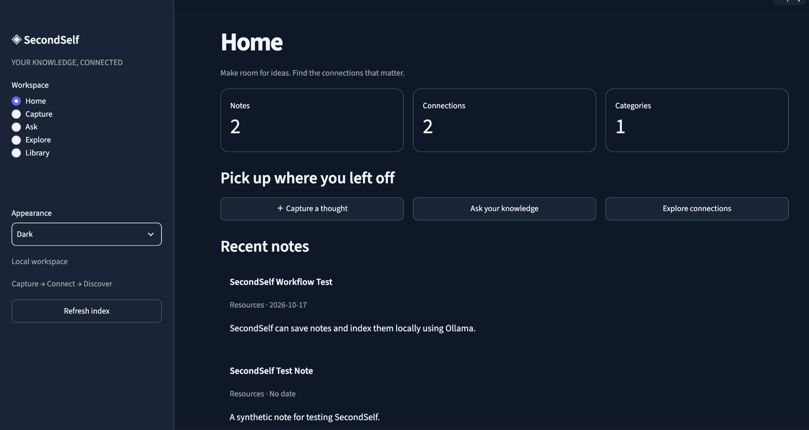
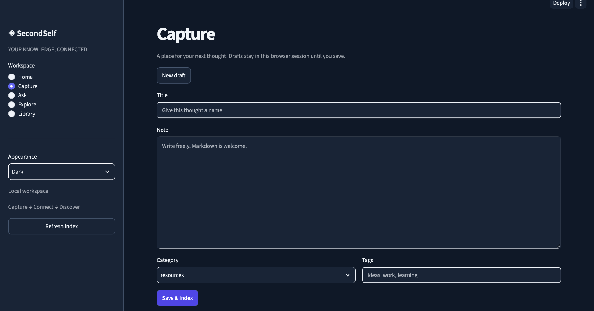
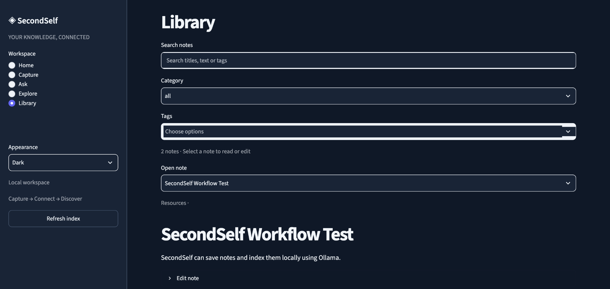
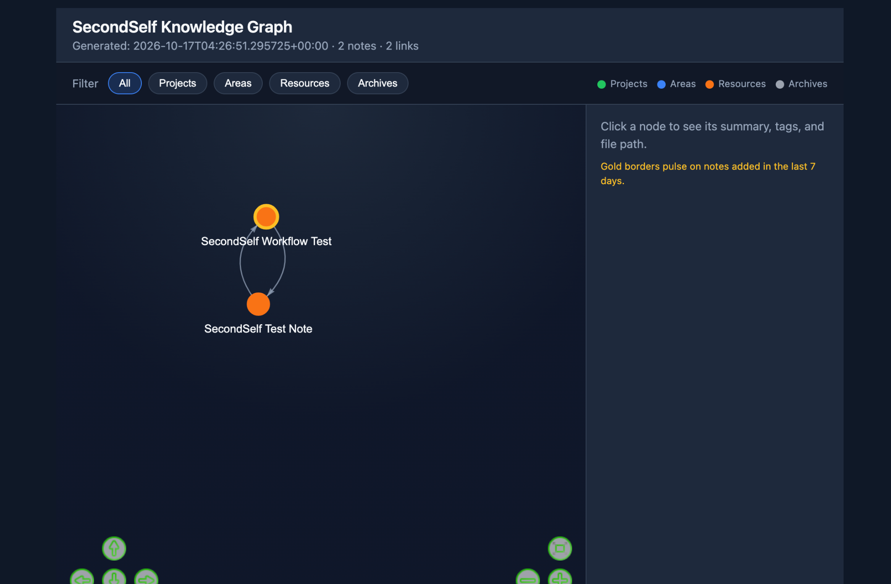
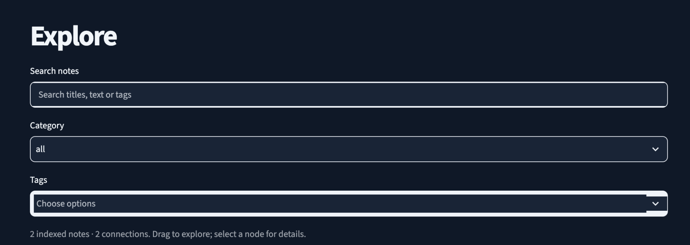

# SecondSelf — Local-first AI Knowledge Workspace

**Capture evidence. Manage datasets. Run reproducible statistics. Explore grounded insights.**

SecondSelf is an AI-assisted personal knowledge system built with Python and Streamlit. It combines Markdown knowledge capture, source-traceable document ingestion, a verified local semantic index, an interactive knowledge graph, AI-assisted evidence review, immutable structured datasets, and locally executed statistical analysis. The **Analyse** feature is on draft PR #21 pending merge.

**Project status:** working local application; document ingestion, AI Insights and Dataset Manager are merged on `main`; statistical Analyse is implemented and verified on draft [PR #21](https://github.com/SQB-KHN/second_brain/pull/21), not yet merged. Not a hosted public product. Private notes remain on the user's machine. A public demo is **not** being claimed here.

[Architecture](docs/portfolio-architecture.md) · [Engineering case study](docs/portfolio-case-study.md) · [Workspace guide](docs/workspace.md) · [Indexing operations](docs/phase2-operations.md)

## Application screenshots

These are real screenshots of the local SecondSelf application, captured using test notes. No live public demo is implied.

| Home | Capture |
| --- | --- |
|  |  |

| Library | Knowledge graph |
| --- | --- |
|  |  |

**Explore — search and filtering**



## Portfolio feature highlights

| Feature | What was engineered | Delivery |
| --- | --- | --- |
| Local-first knowledge and RAG | Markdown capture, source-backed retrieval, Ollama embeddings, transactional freshness checks and interactive knowledge graph | Merged |
| Document intelligence | Previewed PDF/CSV/XLSX imports, retained PDF page and spreadsheet sheet/row provenance, deduplication, retryable ingestion and explicit external-answer consent | [PR #19](https://github.com/SQB-KHN/second_brain/pull/19) — merged |
| AI Insights | Reviewable evidence-backed gap, conflict and connection candidates; persistent review decisions and staleness handling | [PR #18](https://github.com/SQB-KHN/second_brain/pull/18) — merged |
| Structured Dataset Manager | Immutable versioned CSV/XLSX/Parquet storage, column profiling, missingness, metadata dictionaries and reproducible descriptive statistics | [PR #20](https://github.com/SQB-KHN/second_brain/pull/20) — merged |
| Statistical Analyse workspace | Local descriptive and inferential statistics, Pearson/Spearman correlations, paired/independent t-tests, chi-square, OLS/logistic regression, diagnostics, saved manifests, plots and exports | [PR #21](https://github.com/SQB-KHN/second_brain/pull/21) — draft, pending merge |

See the [expanded portfolio feature brief](docs/portfolio-feature-brief.md) for architecture, boundaries, acceptance evidence and scope.

## What it demonstrates

| Capability | Implementation |
| --- | --- |
| Product design | Home, Capture, Ask, Explore, Library, Insights and Datasets on main; Analyse on PR #21 |
| Data workflows | Note capture, PDF/CSV/XLSX evidence ingestion, dataset versioning, schema profiling, descriptive outputs |
| Applied AI / RAG | Ollama `nomic-embed-text` embeddings; source-backed retrieval, document provenance and reviewed Insights |
| Knowledge discovery | Interactive note graph and semantic relationships |
| Reliability | Transactional generations, immutable datasets, content hashes, provenance, bounded processing, repeatable analysis manifests |
| API integration | Optional xAI Grok answer generation and optional OpenAI embedding backend |
| Quality engineering | Automated numerical/reference tests, real-browser acceptance, graph safety checks, GitHub Actions |

### Product walkthrough

1. **Capture:** write a titled note, categorize it, and choose Save Draft or **Save & Index**.
2. **Library:** find, review, and edit saved notes.
3. **Explore:** browse the graph of indexed knowledge and connections.
4. **Ask:** retrieve relevant notes locally; optionally generate a cited answer via a configured LLM.
5. **Home:** see recent activity and knowledge status.

> **Privacy boundary:** Ollama embeddings run locally. With xAI configured, question and retrieved note excerpts are sent to xAI for answer synthesis; provider charges may apply. Classification of queued raw captures is separate and deliberately opt-in.

## Architecture at a glance

```text
Local Streamlit workspace
  ├── Capture / Library → Markdown notes (data/wiki/)
  ├── Save & Index → transactional refresh → Ollama embeddings
  │                        ↓
  │                verified generation (index + vectors + graph)
  ├── Explore ← verified graph
  └── Ask → local semantic retrieval → optional xAI Grok answer + sources

Other inputs: links / files → review queue → explicit classification
Public demo: isolated synthetic data, default-deny publication controls
```

Read the [architecture and design trade-offs](docs/portfolio-architecture.md).

## Run locally (macOS)

Requires Python 3.11+, Ollama, and a suitable Python virtual environment. Commands assume this repository is cloned into `~/second_brain`; adapt the directory to your checkout.

```bash
cd ~/second_brain
python3 -m venv .venv
source .venv/bin/activate
python -m pip install -r requirements.txt

# Install Ollama separately from https://ollama.com/download/mac
ollama pull nomic-embed-text
curl -s http://localhost:11434/api/tags

python refresh.py status --data-dir data
streamlit run app.py --server.address 127.0.0.1
```

Open **http://localhost:8501** and use Capture → **Save & Index**. The UI indexes notes with Ollama when the service is running; no embedding API key is required.

To use Ask for generated answers, optionally add `XAI_API_KEY` to an untracked `.env`. Do **not** commit keys; the question and retrieved passages leave your machine when invoking xAI.

For command-line indexing and recovery:

```bash
python refresh.py dry-run --data-dir data
python refresh.py refresh --data-dir data
python ask.py "What is SecondSelf?"
```

The final command requires a configured LLM answer provider. See [operations](docs/phase2-operations.md) for legacy migration, external API approvals, and failure recovery.

## Engineering evidence

- **Local integration:** a real Ollama smoke test returned 768-dimensional vectors from `nomic-embed-text`.
- **Functional acceptance:** Save & Index, Library visibility, Explore visibility, and an Ask response with a cited local note were manually verified in development.
- **Automated checks:** the local Statistical Engine PR #21 validation reported **124 passing tests** and **five passing browser suites**; its GitHub CI completed successfully. Earlier document and dataset feature deliveries have their own synthetic acceptance checks. These are development checks, **not** independent production quality or statistical validity benchmarks.
- **Delivery history:** [Ollama integration PR #14](https://github.com/SQB-KHN/second_brain/pull/14) and [workspace PR #15](https://github.com/SQB-KHN/second_brain/pull/15).

### Screenshots and short demo

See [portfolio media checklist](docs/portfolio-media.md). Add **actual screenshots** from a synthetic local dataset only after checking for secrets, names, private notes, and identifying paths. Illustrative mockups are not product screenshots. No public URL is advertised until an isolated sample deployment has been verified.

## Engineering approach and attribution

This project was built with **AI-assisted development (Codex)** alongside requirements specification, architectural review, manual acceptance testing, security constraints, and GitHub-based delivery. The case study distinguishes tested behavior from future goals; it does not claim that all code was handwritten.

## Security, privacy, and limitations

- `data/` personal knowledge, generated local indexes, `.env*` secrets, and local logs are excluded from commits by repository ignore rules; **review staged files before every push**.
- Public demo publication is isolated and requires explicit synthetic content approval. No live cloud demo is implied.
- A single-note graph has no semantic edges; usefulness grows with a larger knowledge corpus.
- Search relevance, model hallucinations, multi-user access control, and production-scale performance have not been comprehensively benchmarked.
- The repository does not yet advertise an open-source license. Do not assume reuse rights.

## Tech stack

Python · Streamlit · SQLite · NumPy · SciPy · statsmodels · pyarrow · openpyxl · pypdf · Ollama · nomic-embed-text · source-backed retrieval · optional xAI Grok/OpenAI · unittest · Playwright · GitHub Actions

## Project documentation

- [Five-view workspace guide](docs/workspace.md)
- [Architecture](docs/portfolio-architecture.md)
- [Case study](docs/portfolio-case-study.md)
- [Portfolio media / demonstration checklist](docs/portfolio-media.md)
- [Verified refresh and operations](docs/phase2-operations.md)

### Intelligent document ingestion

Local Capture now supports PDF, UTF-8 CSV and XLSX preview, explicit save and local
Ollama indexing, page/sheet/row citations, duplicate detection and retryable import
history. Imported excerpts require explicit consent before external Ask synthesis.
See [document ingestion operations and limitations](docs/document-ingestion.md).

### AI Insights

The sixth workspace view generates local, evidence-backed candidate gaps,
potential contradictions and connections from the verified index. Review
excerpts, uncertainties and persistent decisions before taking action. See
[AI Insights usage, limits and synthetic acceptance checks](docs/ai-insights.md).

### SecondSelf 2.2: local Datasets workspace

**Datasets** previews and stores CSV, XLSX (selected sheet) and scalar Parquet tables
locally, with immutable source bytes, deduplicated imports, version history, column
profiles/missingness, metadata-only data dictionaries and saved reproducible
descriptive statistics. Dataset values never enter AI prompts or embeddings.
The existing document importer and knowledge workflows remain available.

Run with `DEPLOY_MODE=false` and a private `SECONDSELF_DATA_DIR`, then open Datasets.
Files are limited to 10 MiB, 20,000 rows, 100 columns and 100,000 cells; the read-only
demo does not access datasets. Pyarrow is the additional native dependency.
See [Dataset Manager operations, limits and synthetic demo](docs/dataset-manager.md)
for supported types, persistence/security boundaries and verification commands.

Statistical analysis: [Analyse workspace and numerical conventions](docs/statistical-engine.md).

### SecondSelf 3.1: Analyse workspace (draft PR #21)

On the `statistical-engine-v1` branch, **Analyse** operates on registered immutable dataset versions, runs allowlisted local statistical procedures with SciPy/statsmodels, displays assumptions and diagnostics, and saves reproducible analysis manifests with charts and exports. Supported workflows include correlations, paired/independent t-tests, chi-square, OLS and binary logistic regression. It does **not** run uploaded scripts, compute inferential results with an LLM, establish causation or send dataset values to external AI. See [statistical engine documentation](docs/statistical-engine.md) and [PR #21](https://github.com/SQB-KHN/second_brain/pull/21). The feature is **not in `main` until PR #21 is merged**.
