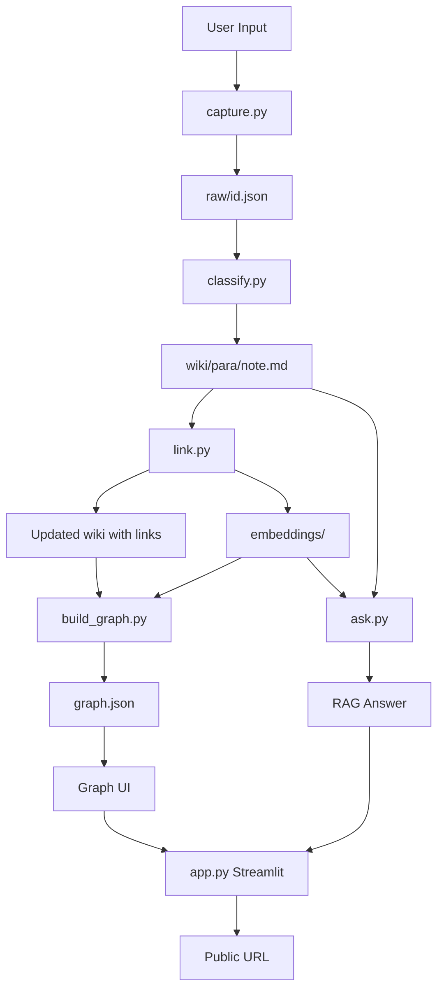

# Secondself System Architecture

Generate implementation-plan.md# SecondSelf — System Architecture

> **Version:** 1.0  
> **Project:** SecondSelf — Personal AI Second Brain  
> **Based on:** Problem Statement (SecondSelf)

---

## 1. Executive Summary

SecondSelf is a **local-first, AI-augmented personal knowledge system** that replaces passive note storage with an active, self-organizing brain. Users capture unstructured inputs (notes, links, files); the system automatically classifies them using the PARA method, links related items via semantic embeddings, visualizes the knowledge as an interactive graph, and answers natural-language questions through retrieval-augmented generation (RAG) over the user's own corpus.

The architecture is deliberately **modular and script-driven**: each pipeline stage is an independent Python module that reads from and writes to a shared filesystem (`raw/` → `wiki/` → `graph.json`), enabling incremental development across four weekly milestones without premature coupling.

---

## 2. Problem → Architecture Mapping

| Problem | Architectural Response |
|---------|------------------------|
| Information goes in but never comes back out | RAG-based `ask()` with embedding retrieval + LLM synthesis |
| Notes sit in folders nobody re-reads | PARA auto-classification moves items into `wiki/` with tags and summaries |
| Knowledge doesn't compound | Embedding similarity auto-links related notes; graph visualization surfaces connections |
| Scattered across apps and tabs | Unified `capture.py` CLI accepts any input type into `raw/` |
| Need public access | Streamlit app deployed to Streamlit Cloud / Hugging Face Spaces |

---

## 3. High-Level Architecture

```text
┌─────────────────────────────────────────────────────────────────────────────┐
│                           USER INTERACTION LAYER                            │
│  ┌──────────────────┐  ┌──────────────────┐  ┌──────────────────────────┐ │
│  │  capture.py CLI  │  │  Streamlit App   │  │  (Future: API / webhook) │ │
│  │  one-command     │  │  graph + ask UI    │  │                          │ │
│  └────────┬─────────┘  └────────┬─────────┘  └──────────────────────────┘ │
└───────────┼─────────────────────┼─────────────────────────────────────────┘
            │                       │
            ▼                       ▼
┌─────────────────────────────────────────────────────────────────────────────┐
│                         PROCESSING PIPELINE (Python)                        │
│                                                                             │
│  ┌──────────┐   ┌────────────┐   ┌──────────┐   ┌─────────────┐   ┌──────┐ │
│  │ CAPTURE  │──▶│ CLASSIFY   │──▶│   LINK   │──▶│ BUILD_GRAPH │──▶│ ASK  │ │
│  │ Week 1   │   │ Week 2     │   │ Week 2   │   │ Week 3      │   │ Wk 4 │ │
│  └──────────┘   └────────────┘   └──────────┘   └─────────────┘   └──────┘ │
└─────────────────────────────────────────────────────────────────────────────┘
            │                       │                       │
            ▼                       ▼                       ▼
┌─────────────────────────────────────────────────────────────────────────────┐
│                            DATA / STORAGE LAYER                             │
│  ┌──────────┐   ┌──────────┐   ┌──────────────┐   ┌─────────────────────┐ │
│  │  raw/    │   │  wiki/   │   │  graph.json  │   │  embeddings store   │ │
│  │ captures │   │ PARA org │   │ nodes/edges  │   │  (vectors per note) │ │
│  └──────────┘   └──────────┘   └──────────────┘   └─────────────────────┘ │
└─────────────────────────────────────────────────────────────────────────────┘
            │
            ▼
┌─────────────────────────────────────────────────────────────────────────────┐
│                         EXTERNAL SERVICES (APIs)                            │
│  ┌────────────────────┐   ┌────────────────────┐   ┌──────────────────┐ │
│  │  LLM Provider      │   │  Embedding Model   │   │  Deployment Host │ │
│  │  (classification,  │   │  (OpenAI / local   │   │  Streamlit Cloud │ │
│  │   summarization,   │   │   sentence-transf.)│   │  HF Spaces       │ │
│  │   RAG synthesis)   │   │                    │   │                  │ │
│  └────────────────────┘   └────────────────────┘   └──────────────────┘ │
└─────────────────────────────────────────────────────────────────────────────┘
```

---

## 4. Core Design Principles

1. **Filesystem as source of truth** — No database in v1. Markdown files in `wiki/` are human-readable, git-friendly, and inspectable.
2. **Pipeline stages are independent scripts** — Each module can be run manually or chained; failures are localized.
3. **Idempotent re-runs** — Re-classifying or re-linking should not corrupt data; use stable IDs and overwrite semantics.
4. **Local-first, cloud-deployable** — Development runs entirely on disk; deployment wraps the same code in Streamlit.
5. **Progressive enrichment** — Raw capture is minimal; metadata layers (PARA, tags, links, embeddings) are added incrementally.

---

## 5. Component Architecture

### 5.1 Capture Module (`capture.py`) — Week 1

**Responsibility:** Accept any user input and persist it immutably in `raw/`.

```text
Input Types:
  ├── Plain text note      → stdin or --text flag
  ├── URL / bookmark       → --url flag
  └── File (PDF, image…)   → --file path

Output:
  raw/{uuid}_{timestamp}.json
```

**Capture record schema:**

```json
{
  "id": "550e8400-e29b-41d4-a716-446655440000",
  "timestamp": "2026-08-03T10:30:00Z",
  "type": "note | link | file",
  "content": "raw text or extracted text",
  "source_url": "optional URL",
  "file_path": "optional path to copied file in raw/assets/",
  "metadata": {}
}
```

**Design decisions:**
- UUID v4 for globally unique, collision-free IDs across re-imports.
- Original files copied to `raw/assets/` to preserve provenance.
- JSON (not plain markdown) in `raw/` to support heterogeneous capture types in one folder.
- CLI entry point: `python capture.py --text "idea"`, `python capture.py --url https://…`, `python capture.py --file doc.pdf`.

---

### 5.2 Classification Module (`classify.py`) — Week 2

**Responsibility:** Transform raw captures into organized wiki notes with PARA category, tags, and summary.

```text
raw/{id}.json  ──▶  LLM (structured prompt)  ──▶  wiki/{para}/{slug}.md
```

**PARA taxonomy:**

| Category | Folder | Meaning |
|----------|--------|---------|
| Projects | `wiki/projects/` | Active work with a deadline |
| Areas | `wiki/areas/` | Ongoing responsibilities |
| Resources | `wiki/resources/` | Reference material for future use |
| Archives | `wiki/archives/` | Inactive / completed items |

**Wiki note frontmatter schema:**

```yaml
---
id: "550e8400-e29b-41d4-a716-446655440000"
created: "2026-08-03T10:30:00Z"
para: "projects"
tags: ["ai", "second-brain", "architecture"]
summary: "One-line summary of the capture"
source_type: "note"
links: []          # populated by link.py
embedding_id: ""   # reference to embedding vector
---
```

**LLM prompt strategy:**
- System prompt defines PARA categories with examples.
- User prompt includes raw content + optional context (existing tags in corpus).
- Response parsed as structured JSON: `{ para, tags, summary, title }`.
- Slug generated from title (lowercase, hyphenated).

**Processing flow:**
1. Scan `raw/` for captures without a corresponding `wiki/` entry (match by `id`).
2. For each unprocessed capture, call LLM.
3. Write markdown file with YAML frontmatter + body (original content, optionally cleaned).
4. Log classification result to `wiki/.index.json` for fast lookups.

---

### 5.3 Auto-Linking Module (`link.py`) — Week 2

**Responsibility:** Compute embeddings, find semantically similar notes, and inject bidirectional `[[wiki-links]]` into markdown files.

```text
wiki/*.md  ──▶  Embedding API  ──▶  embeddings/{id}.npy
                    │
                    ▼
              Cosine similarity matrix
                    │
                    ▼
         Threshold filter (e.g. ≥ 0.82)
                    │
                    ▼
         Update frontmatter links + inline [[links]]
```

**Embedding store:**

```text
embeddings/
├── index.json          # { "note_id": "path/to/vector.npy", ... }
└── {note_id}.npy       # float32 vector (e.g. 1536-dim)
```

**Similarity & linking algorithm:**

```python
# Pseudocode
for new_note in unembedded_notes:
    vector = embed(new_note.content)
    save(vector)

for new_note in newly_embedded:
    scores = cosine_similarity(new_note.vector, all_vectors)
    related = [id for id, score in scores if score >= THRESHOLD]
    update_frontmatter_links(new_note, related)
    append_inline_links(new_note.body, related)
```

**Design decisions:**
- Threshold default: `0.82` (tunable via config or CLI flag).
- Bidirectional links: when A links to B, B's frontmatter also gains A (optional, configurable).
- Re-run safe: diff existing links vs computed links; only add new ones (never remove manual links).
- Batch embedding on first run; incremental on new captures only.

---

### 5.4 Graph Builder (`build_graph.py`) — Week 3

**Responsibility:** Parse all wiki notes, extract nodes and edges, export `graph.json` for visualization.

```text
wiki/**/*.md  ──▶  Parse frontmatter + [[links]]  ──▶  graph.json
```

**Graph JSON schema:**

```json
{
  "nodes": [
    {
      "id": "550e8400-e29b-41d4-a716-446655440000",
      "label": "SecondSelf Architecture",
      "para": "projects",
      "tags": ["ai", "architecture"],
      "summary": "System design for personal second brain",
      "path": "wiki/projects/secondself-architecture.md",
      "created": "2026-08-03T10:30:00Z"
    }
  ],
  "edges": [
    {
      "source": "uuid-a",
      "target": "uuid-b",
      "type": "semantic | explicit",
      "weight": 0.87
    }
  ],
  "meta": {
    "generated_at": "2026-08-03T12:00:00Z",
    "node_count": 42,
    "edge_count": 78
  }
}
```

**Edge types:**
- `explicit` — from `[[wiki-link]]` or frontmatter `links` array.
- `semantic` — from embedding similarity (weight = cosine score).

**Node attributes for visualization:**
- Color by PARA category (Projects=green, Areas=blue, Resources=orange, Archives=gray).
- Size by number of connections (degree).

---

### 5.5 Graph Visualization — Week 3

**Responsibility:** Interactive force-directed graph in the browser.

**Technology:** `vis-network` (preferred) or `Cytoscape.js` embedded in HTML, or Streamlit custom component.

**Features:**

| Feature | Implementation |
|---------|----------------|
| Force-directed layout | vis-network physics engine |
| Hover popup | Show summary + tags on node hover |
| Drag | Native vis-network interaction |
| Zoom / pan | Mouse wheel + drag background |
| Animated nodes | Pulse animation on recently added nodes |
| Click to open | Navigate to wiki markdown or show detail panel |

**Standalone HTML option (Week 3 dev):**

```text
graph.html  ← loads graph.json + vis-network CDN
```

**Streamlit integration (Week 4):** `st.components.v1.html()` embeds the same graph widget inside `app.py`.

---

### 5.6 Ask Module (`ask.py`) — Week 4

**Responsibility:** Natural-language Q&A over the personal knowledge base via RAG.

```text
User question
      │
      ▼
Embed question  ──▶  Retrieve top-k similar notes (cosine)
      │
      ▼
Build context window (note summaries + excerpts)
      │
      ▼
LLM synthesis  ──▶  Answer + source citations
```

**RAG pipeline:**

```python
def ask(question: str, top_k: int = 5) -> AskResult:
    q_vector = embed(question)
    candidates = retrieve_top_k(q_vector, embeddings_index, k=top_k)
    context = format_context(candidates)  # summaries + key paragraphs
    prompt = build_rag_prompt(question, context)
    answer = llm.complete(prompt)
    return AskResult(answer=answer, sources=candidates)
```

**Prompt template (system):**

```text
You are SecondSelf, a personal knowledge assistant.
Answer ONLY from the provided context (the user's own notes).
If the context doesn't contain enough information, say so explicitly.
Cite sources by note title. Do not hallucinate facts not in the context.
```

**Return schema:**

```json
{
  "question": "What architecture decisions did I make for SecondSelf?",
  "answer": "You chose a filesystem-first design with...",
  "sources": [
    { "id": "uuid", "title": "SecondSelf Architecture", "score": 0.91 }
  ],
  "tokens_used": 1200
}
```

---

### 5.7 Streamlit Application (`app.py`) — Week 4

**Responsibility:** Unified web UI combining graph exploration and Q&A; deployed publicly.

```text
┌─────────────────────────────────────────────────────────┐
│  SecondSelf                              [sidebar]      │
├─────────────────────────────────────────────────────────┤
│                                                         │
│  ┌─────────────────────────────────────────────────┐   │
│  │         Interactive Knowledge Graph             │   │
│  │         (vis-network embedded)                  │   │
│  └─────────────────────────────────────────────────┘   │
│                                                         │
│  ┌─────────────────────────────────────────────────┐   │
│  │  Ask anything...                          [Ask] │   │
│  └─────────────────────────────────────────────────┘   │
│                                                         │
│  Answer panel with source citations                     │
│                                                         │
└─────────────────────────────────────────────────────────┘
```

**App structure:**

```python
# app.py (conceptual)
import streamlit as st

st.set_page_config(page_title="SecondSelf", layout="wide")

# Sidebar: stats, re-run pipeline buttons, PARA filter
with st.sidebar:
    st.metric("Notes", node_count)
    st.selectbox("Filter by PARA", ["All", "Projects", "Areas", ...])

# Main: graph (top) + ask (bottom)
st.components.v1.html(graph_html, height=500)
question = st.text_input("Ask anything about your knowledge...")
if question:
    result = ask(question)
    st.markdown(result.answer)
    st.caption("Sources: " + ", ".join(result.sources))
```

**Deployment targets:**
- **Streamlit Cloud** — connect GitHub repo, set `app.py` as entry, add API keys as secrets.
- **Hugging Face Spaces** — Docker or Streamlit SDK space with same entry point.

---

## 6. Data Flow (End-to-End)



**Typical user session:**

1. `python capture.py --text "Meeting notes about PARA method"`
2. `python classify.py` → note filed under `wiki/areas/productivity.md`
3. `python link.py` → linked to existing "Second Brain" resource note
4. `python build_graph.py` → graph.json updated
5. Open Streamlit app → see new node connected to related notes
6. Ask: "What do I know about note organization?" → synthesized answer

---

## 7. Repository Structure

```text
secondself/
├── raw/                          # Immutable captures (Week 1)
│   ├── assets/                   # Copied files (PDFs, images)
│   └── {uuid}_{ts}.json
├── wiki/                         # Organized notes (Week 2+)
│   ├── projects/
│   ├── areas/
│   ├── resources/
│   ├── archives/
│   └── .index.json               # Fast lookup index
├── embeddings/                   # Vector store (Week 2)
│   ├── index.json
│   └── {id}.npy
├── docs/                         # Documentation
│   ├── problemStatement.md
│   ├── architecture.md           # This file
│   ├── implementation-plan.md
│   └── edge-case.md
├── capture.py                    # Week 1
├── classify.py                   # Week 2
├── link.py                       # Week 2
├── build_graph.py                # Week 3
├── graph.json                    # Week 3 output
├── graph.html                    # Week 3 standalone viewer (optional)
├── ask.py                        # Week 4
├── app.py                        # Week 4 Streamlit app
├── config.py                     # Shared config (paths, thresholds, API keys)
├── requirements.txt
├── .streamlit/config.toml        # Streamlit theme
├── .env.example                  # API key template (never commit .env)
└── README.md
```

---

## 8. Technology Stack

| Layer | Technology | Rationale |
|-------|------------|-----------|
| Language | Python 3.11+ | Ecosystem for LLM, embeddings, Streamlit |
| Capture CLI | `argparse` / `click` | Simple, no framework overhead |
| Storage | Filesystem (JSON + Markdown) | Human-readable, git-friendly, zero ops |
| Embeddings | OpenAI `text-embedding-3-small` or `sentence-transformers` (local) | Quality vs cost tradeoff |
| LLM | OpenAI GPT-4o-mini / Anthropic Claude (via API) | Classification + RAG synthesis |
| Vector ops | `numpy` + manual cosine similarity | Sufficient for personal corpus (<10k notes) |
| Graph viz | vis-network 9.x | Mature, force-directed, CDN-available |
| Web app | Streamlit 1.3x | Fast deploy, Python-native, HF/Streamlit Cloud |
| Deployment | Streamlit Cloud / Hugging Face Spaces | Free tier, GitHub integration |
| Config | `python-dotenv` + `config.py` | API keys via environment variables |

**Future upgrade path (out of v1 scope):**
- SQLite or Chroma for embedding index at scale
- FastAPI backend if API access needed
- Webhook capture (Zapier, browser extension)

---

## 9. Configuration (`config.py`)

```python
# Centralized configuration
RAW_DIR = "raw"
WIKI_DIR = "wiki"
EMBEDDINGS_DIR = "embeddings"
GRAPH_FILE = "graph.json"

SIMILARITY_THRESHOLD = 0.82
RAG_TOP_K = 5
EMBEDDING_MODEL = "text-embedding-3-small"
LLM_MODEL = "gpt-4o-mini"

PARA_FOLDERS = ["projects", "areas", "resources", "archives"]
PARA_COLORS = {
    "projects": "#22c55e",
    "areas": "#3b82f6",
    "resources": "#f97316",
    "archives": "#9ca3af",
}
```

---

## 10. Security & Privacy

| Concern | Mitigation |
|---------|------------|
| API keys in code | `.env` + Streamlit secrets; never commit |
| Personal data in cloud deploy | User controls what gets captured; warn in README |
| Public URL exposure | Deploy demo corpus only, or auth gate (future) |
| File upload safety | Validate file types; size limits in `capture.py` |
| LLM data leakage | Use API providers with no-training policies; local embeddings option |

**v1 assumption:** Single-user personal deployment. Multi-user auth is out of scope.

---

## 11. Deployment Architecture

```text
GitHub Repository
       │
       ├──▶ Streamlit Cloud
       │         ├── Build: pip install -r requirements.txt
       │         ├── Entry: app.py
       │         └── Secrets: OPENAI_API_KEY
       │
       └──▶ Hugging Face Spaces
                 ├── SDK: Streamlit
                 ├── Same entry + secrets
                 └── Public URL: huggingface.co/spaces/{user}/secondself
```

**Cold start considerations:**
- Pre-build `graph.json` and commit to repo (or generate on first app load).
- Embeddings loaded lazily on first `ask()` call.
- Graph rendered from static `graph.json` — no live pipeline in request path.

**Pipeline execution:**
- Development: manual script runs after each capture.
- Production app: optional "Refresh brain" button triggers classify → link → build_graph subprocess chain.

---

## 12. Observability & Logging

```text
logs/
└── pipeline.log        # Timestamped events per script run
```

Each module logs:
- Items processed / skipped / failed
- LLM token usage (classification + ask)
- Similarity scores for new links
- Graph node/edge counts

No external monitoring in v1; log file sufficient for debugging.

---

## 13. Performance Expectations (Personal Scale)

| Operation | Expected corpus | Target latency |
|-----------|-----------------|----------------|
| Capture | any | < 1s |
| Classify (1 note) | — | 2–5s (LLM call) |
| Link (1 new note) | 100 notes | < 2s |
| Build graph | 500 notes | < 5s |
| Ask (RAG) | 500 notes | 3–8s |
| Graph render | 500 nodes | < 3s in browser |

Corpus sizes beyond ~5,000 notes may require vector DB migration (future).

---

## 14. Milestone → Component Traceability

| Week | Badge | Modules | Storage artifacts |
|------|-------|---------|-------------------|
| 1 | The Archivist | `capture.py` | `raw/*.json` |
| 2 | The Librarian | `classify.py`, `link.py` | `wiki/**/*.md`, `embeddings/` |
| 3 | The Cartographer | `build_graph.py`, graph UI | `graph.json` |
| 4 | The Oracle | `ask.py`, `app.py` | Deployed public URL |

---

## 15. Interface Contracts (Module Boundaries)

Each module exposes a clear contract so stages can be developed and tested independently:

```text
capture.py
  INPUT:  CLI args (text, url, file)
  OUTPUT: raw/{id}.json
  ERRORS: Invalid file type, disk full

classify.py
  INPUT:  raw/*.json without wiki counterpart
  OUTPUT: wiki/{para}/{slug}.md + wiki/.index.json
  ERRORS: LLM timeout, unparseable response → retry + fallback to "resources"

link.py
  INPUT:  wiki/**/*.md, embeddings/
  OUTPUT: Updated frontmatter links, embeddings/{id}.npy
  ERRORS: Embedding API failure → skip note, log warning

build_graph.py
  INPUT:  wiki/**/*.md, embeddings/index.json
  OUTPUT: graph.json
  ERRORS: Missing frontmatter → skip node, log warning

ask.py
  INPUT:  question string, optional top_k
  OUTPUT: AskResult (answer + sources)
  ERRORS: No embeddings → "Brain not indexed yet"
```

---

## 16. Summary

SecondSelf's architecture is a **linear enrichment pipeline** over a filesystem-backed knowledge store, augmented by LLM classification and embedding-based linking, culminating in a Streamlit-hosted graph explorer and RAG Q&A interface. The design optimizes for:

- **Incremental buildability** — four weekly milestones map 1:1 to pipeline stages.
- **Transparency** — every artifact is a file you can open and edit.
- **Low operational cost** — no database, no container orchestration in v1.
- **Personal scale** — numpy cosine search is fast enough for hundreds to thousands of notes.

The system is not a notes app or a chatbot; it is a **self-organizing knowledge graph with a question-answering layer** built entirely from the user's own accumulated captures.
