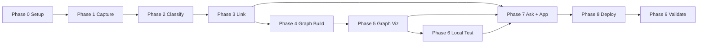

# SecondSelf — Implementation Plan

> **Version:** 1.0  
> **Project:** SecondSelf — Personal AI Second Brain  
> **References:** `problemStatement.md`, `architecture.md`  
> **Timeline:** 4 weeks (9 implementation phases)

---

## Overview

This plan breaks the SecondSelf build into **9 sequential phases** mapped to **4 weekly milestones**. Each phase has concrete tasks, file outputs, verification steps, and acceptance criteria. Phases are designed to be completable in order — never skip ahead without meeting the prior phase's criteria.

```text
Phase 0 ─ Setup
    ↓
Phase 1 ─ Capture          ── Week 1: The Archivist
    ↓
Phase 2 ─ Classification   ── Week 2: The Librarian (part 1)
    ↓
Phase 3 ─ Auto-Linking     ── Week 2: The Librarian (part 2)
    ↓
Phase 4 ─ Graph Build      ── Week 3: The Cartographer (part 1)
    ↓
Phase 5 ─ Graph Viz        ── Week 3: The Cartographer (part 2)
    ↓
Phase 6 ─ Local Testing
    ↓
Phase 7 ─ Integration      ── Week 4: The Oracle (part 1)
    ↓
Phase 8 ─ Deployment       ── Week 4: The Oracle (part 2)
    ↓
Phase 9 ─ Final Validation
```

---

## Phase Summary Table

| Phase | Name | Week | Badge | Key Output | Est. Time |
|-------|------|------|-------|------------|-----------|
| 0 | Setup | Pre | — | Repo scaffold, config, deps | 2–4 hrs |
| 1 | Capture Pipeline | 1 | The Archivist | `capture.py`, `raw/` | 4–6 hrs |
| 2 | Classification | 2 | — | `classify.py`, `wiki/` | 6–8 hrs |
| 3 | Auto-Linking | 2 | The Librarian | `link.py`, `embeddings/` | 6–8 hrs |
| 4 | Graph Construction | 3 | — | `build_graph.py`, `graph.json` | 4–6 hrs |
| 5 | Graph Visualization | 3 | The Cartographer | `graph.html` or viz component | 6–8 hrs |
| 6 | Local Testing | 3–4 | — | Test log, bug fixes | 4–6 hrs |
| 7 | Integration | 4 | — | `ask.py`, `app.py` | 8–10 hrs |
| 8 | Deployment | 4 | — | Public URL live | 3–5 hrs |
| 9 | Final Validation | 4 | The Oracle | README, E2E verified | 2–4 hrs |

---

## Phase 0 — Setup

**Goal:** Scaffold the repository, install dependencies, configure environment. No feature code yet.

**Week:** Pre-build  
**Depends on:** Nothing

### Tasks

| # | Task | File(s) |
|---|------|---------|
| 0.1 | Create project root directory `secondself/` | — |
| 0.2 | Create folder structure: `raw/`, `raw/assets/`, `wiki/projects/`, `wiki/areas/`, `wiki/resources/`, `wiki/archives/`, `embeddings/`, `logs/`, `docs/` | directories |
| 0.3 | Add `.gitkeep` to empty dirs so Git tracks them | `raw/.gitkeep`, etc. |
| 0.4 | Create `config.py` with paths, thresholds, model names | `config.py` |
| 0.5 | Create `requirements.txt` | `requirements.txt` |
| 0.6 | Create `.env.example` with `OPENAI_API_KEY=` placeholder | `.env.example` |
| 0.7 | Create `.gitignore` (`.env`, `__pycache__/`, `*.pyc`, `.DS_Store`) | `.gitignore` |
| 0.8 | Create minimal `README.md` with project name and setup stub | `README.md` |
| 0.9 | Create `.streamlit/config.toml` for wide layout theme | `.streamlit/config.toml` |
| 0.10 | Install dependencies: `pip install -r requirements.txt` | — |
| 0.11 | Copy `.env.example` → `.env` and add API key | `.env` |
| 0.12 | Verify Python 3.11+: `python --version` | — |

### `requirements.txt` (initial)

```text
openai>=1.30.0
python-dotenv>=1.0.0
pyyaml>=6.0.1
numpy>=1.26.0
streamlit>=1.35.0
requests>=2.31.0
beautifulsoup4>=4.12.0
pypdf>=4.0.0
```

### `config.py` (initial)

```python
import os
from pathlib import Path
from dotenv import load_dotenv

load_dotenv()

ROOT = Path(__file__).parent
RAW_DIR = ROOT / "raw"
RAW_ASSETS_DIR = RAW_DIR / "assets"
WIKI_DIR = ROOT / "wiki"
EMBEDDINGS_DIR = ROOT / "embeddings"
LOGS_DIR = ROOT / "logs"
GRAPH_FILE = ROOT / "graph.json"

SIMILARITY_THRESHOLD = 0.82
RAG_TOP_K = 5
EMBEDDING_MODEL = "text-embedding-3-small"
LLM_MODEL = "gpt-4o-mini"

PARA_FOLDERS = ["projects", "areas", "resources", "archives"]
PARA_COLORS = {
    "projects": "#22c55e",
    "areas": "#3b82f6",
    "resources": "#f97316",
    "archives": "#9ca3af",
}

OPENAI_API_KEY = os.getenv("OPENAI_API_KEY", "")
```

### Acceptance Criteria

- [ ] All directories exist per architecture spec
- [ ] `pip install -r requirements.txt` succeeds with no errors
- [ ] `config.py` imports without error: `python -c "import config"`
- [ ] `.env` exists locally (not committed)
- [ ] `docs/` contains `architecture.md` and this file

### Verification Command

```bash
python -c "from config import RAW_DIR, WIKI_DIR; print('Setup OK', RAW_DIR, WIKI_DIR)"
```

---

## Phase 1 — Capture Pipeline

**Goal:** One command captures any note, link, or file into `raw/` with timestamp and unique ID.

**Week:** 1 — **Badge: The Archivist**  
**Depends on:** Phase 0

### Tasks

| # | Task | File(s) |
|---|------|---------|
| 1.1 | Implement UUID + ISO timestamp generation helper | `capture.py` |
| 1.2 | Implement `--text` flag (plain note capture) | `capture.py` |
| 1.3 | Implement `--url` flag (fetch page title + snippet via requests/BS4) | `capture.py` |
| 1.4 | Implement `--file` flag (copy to `raw/assets/`, extract text for PDFs) | `capture.py` |
| 1.5 | Write capture JSON to `raw/{uuid}_{timestamp}.json` | `capture.py` |
| 1.6 | Add logging to `logs/pipeline.log` | `capture.py` |
| 1.7 | Add `--help` and usage examples in docstring | `capture.py` |
| 1.8 | Capture **10+ real personal items** (mix of note, link, file) | `raw/` |

### Capture JSON Schema (enforce in code)

```json
{
  "id": "uuid-v4",
  "timestamp": "ISO-8601",
  "type": "note | link | file",
  "content": "string",
  "source_url": "optional",
  "file_path": "optional relative path",
  "metadata": {}
}
```

### CLI Usage (target)

```bash
python capture.py --text "Idea: use PARA for all captures"
python capture.py --url "https://example.com/article"
python capture.py --file "/path/to/document.pdf"
```

### Acceptance Criteria

- [ ] `raw/` and `wiki/` folders exist
- [ ] One command captures a note, a link, and a file
- [ ] Every capture has `id` + `timestamp`
- [ ] Files copied to `raw/assets/` with reference in JSON
- [ ] 10+ real items in `raw/`
- [ ] Invalid file path prints clear error, does not crash

### Verification Commands

```bash
python capture.py --text "Test note"
ls raw/*.json | wc -l    # expect >= 10
python -c "import json; d=json.load(open(sorted(__import__('pathlib').Path('raw').glob('*.json'))[0])); assert 'id' in d and 'timestamp' in d"
```

---

## Phase 2 — Classification

**Goal:** AI auto-classifies every raw capture into PARA-organized wiki markdown with tags and summary.

**Week:** 2 (part 1)  
**Depends on:** Phase 1 (raw captures exist)

### Tasks

| # | Task | File(s) |
|---|------|---------|
| 2.1 | Implement raw capture scanner (find unprocessed by `id`) | `classify.py` |
| 2.2 | Build LLM system prompt defining PARA categories + examples | `classify.py` |
| 2.3 | Call OpenAI API with structured JSON response parsing | `classify.py` |
| 2.4 | Generate slug from title (lowercase, hyphenated, unique) | `classify.py` |
| 2.5 | Write wiki markdown with YAML frontmatter | `wiki/{para}/{slug}.md` |
| 2.6 | Maintain `wiki/.index.json` for id → path lookup | `wiki/.index.json` |
| 2.7 | Handle LLM failures: retry once, fallback para=`resources` | `classify.py` |
| 2.8 | Add `--dry-run` flag to preview without writing | `classify.py` |
| 2.9 | Run on all raw captures; verify 15+ organized notes | `wiki/` |

### Wiki Frontmatter (enforce in code)

```yaml
---
id: "uuid"
created: "ISO-8601"
para: "projects | areas | resources | archives"
tags: ["tag1", "tag2"]
summary: "One-line summary"
source_type: "note | link | file"
links: []
embedding_id: ""
---
```

### LLM Response Schema (parse strictly)

```json
{
  "title": "string",
  "para": "projects | areas | resources | archives",
  "tags": ["string"],
  "summary": "string"
}
```

### Acceptance Criteria

- [ ] Automatic PARA category assigned
- [ ] Automatic tags generated (≥1 per note)
- [ ] Automatic one-line summary
- [ ] Notes written to correct `wiki/{para}/` subfolder
- [ ] Re-run skips already-classified captures (idempotent)
- [ ] 15+ real items organized in `wiki/`

### Verification Commands

```bash
python classify.py
find wiki -name "*.md" | wc -l    # expect >= 15
python classify.py                # second run: 0 new files
```

---

## Phase 3 — Auto-Linking

**Goal:** Compute embeddings, find similar notes, inject links automatically.

**Week:** 2 (part 2) — **Badge: The Librarian**  
**Depends on:** Phase 2 (wiki notes exist)

### Tasks

| # | Task | File(s) |
|---|------|---------|
| 3.1 | Implement note content loader (frontmatter + body) | `link.py` |
| 3.2 | Call embedding API for each unembedded note | `link.py` |
| 3.3 | Save vectors as `embeddings/{id}.npy` + update `embeddings/index.json` | `embeddings/` |
| 3.4 | Implement cosine similarity with numpy | `link.py` |
| 3.5 | Filter pairs above `SIMILARITY_THRESHOLD` (default 0.82) | `link.py` |
| 3.6 | Update frontmatter `links` array on matched notes | `wiki/**/*.md` |
| 3.7 | Append `## Related` section with `[[wiki-links]]` if not present | `wiki/**/*.md` |
| 3.8 | Optional bidirectional linking (config flag) | `link.py` |
| 3.9 | Add `--threshold` CLI override | `link.py` |
| 3.10 | Log similarity scores for new links | `logs/pipeline.log` |

### Embedding Index Schema

```json
{
  "550e8400-e29b-41d4-a716-446655440000": {
    "path": "embeddings/550e8400....npy",
    "wiki_path": "wiki/projects/secondself-architecture.md",
    "updated": "ISO-8601"
  }
}
```

### Acceptance Criteria

- [ ] Embeddings computed for all wiki notes
- [ ] `embeddings/index.json` populated
- [ ] Related notes linked when similarity ≥ threshold
- [ ] Re-run only processes new/unembedded notes
- [ ] Manual links in frontmatter are never removed
- [ ] At least one note has ≥2 auto-generated links (with sufficient corpus)

### Verification Commands

```bash
python link.py
ls embeddings/*.npy | wc -l       # matches wiki note count
python -c "import json; idx=json.load(open('embeddings/index.json')); print(len(idx), 'embeddings')"
grep -r "links:" wiki --include="*.md" | head
```

---

## Phase 4 — Graph Construction

**Goal:** Build `graph.json` with nodes and edges from wiki notes and links.

**Week:** 3 (part 1)  
**Depends on:** Phase 3 (links exist)

### Tasks

| # | Task | File(s) |
|---|------|---------|
| 4.1 | Walk `wiki/**/*.md`, parse YAML frontmatter | `build_graph.py` |
| 4.2 | Build node list: id, label, para, tags, summary, path, created | `build_graph.py` |
| 4.3 | Extract explicit edges from frontmatter `links` and `[[wiki-links]]` | `build_graph.py` |
| 4.4 | Add semantic edges from embedding similarity (optional weight) | `build_graph.py` |
| 4.5 | Deduplicate edges (same source-target pair) | `build_graph.py` |
| 4.6 | Write `graph.json` with `meta` block (counts, timestamp) | `graph.json` |
| 4.7 | Compute node degree for visualization sizing | `build_graph.py` |
| 4.8 | Handle missing/broken frontmatter gracefully (skip + log) | `build_graph.py` |

### Graph JSON (validate output)

```json
{
  "nodes": [...],
  "edges": [
    { "source": "uuid-a", "target": "uuid-b", "type": "explicit | semantic", "weight": 0.87 }
  ],
  "meta": { "generated_at": "...", "node_count": N, "edge_count": M }
}
```

### Acceptance Criteria

- [ ] Nodes generated for every valid wiki note
- [ ] Edges generated for explicit and semantic links
- [ ] `graph.json` is valid JSON
- [ ] `meta.node_count` matches actual node array length
- [ ] Re-run updates graph without data loss

### Verification Commands

```bash
python build_graph.py
python -c "import json; g=json.load(open('graph.json')); print(g['meta']); assert len(g['nodes'])==g['meta']['node_count']"
```

---

## Phase 5 — Graph Visualization

**Goal:** Interactive force-directed graph with hover, drag, zoom — built from real notes.

**Week:** 3 (part 2) — **Badge: The Cartographer**  
**Depends on:** Phase 4 (`graph.json` exists)

### Tasks

| # | Task | File(s) |
|---|------|---------|
| 5.1 | Create standalone `graph.html` loading vis-network from CDN | `graph.html` |
| 5.2 | Load `graph.json` and map to vis-network nodes/edges format | `graph.html` |
| 5.3 | Color nodes by PARA category (`PARA_COLORS`) | `graph.html` |
| 5.4 | Size nodes by degree (connection count) | `graph.html` |
| 5.5 | Hover popup: title, summary, tags | `graph.html` |
| 5.6 | Enable drag, zoom, pan (vis-network defaults) | `graph.html` |
| 5.7 | Add pulse animation for nodes created in last 7 days | `graph.html` |
| 5.8 | Click node → show detail panel or alert with summary | `graph.html` |
| 5.9 | Create `render_graph.py` helper to generate HTML from `graph.json` (for Streamlit reuse) | `render_graph.py` |
| 5.10 | Test with full real corpus in browser | manual |

### vis-network Node Mapping

```javascript
{
  id: node.id,
  label: node.label,
  color: PARA_COLORS[node.para],
  size: 10 + node.degree * 2,
  title: `${node.summary}\nTags: ${node.tags.join(', ')}`
}
```

### Acceptance Criteria

- [ ] Nodes visible in browser
- [ ] Edges connect related nodes
- [ ] Hover shows summary popup
- [ ] Drag repositions nodes
- [ ] Zoom and pan work
- [ ] Built entirely from real wiki notes (not mock data)
- [ ] Graph readable with 15+ nodes

### Verification

```bash
python build_graph.py && open graph.html   # or python -m http.server
# Manual: hover, drag, zoom on 3+ nodes
```

---

## Phase 6 — Local Testing

**Goal:** Systematically test each module and fix bugs before integration.

**Week:** 3–4 bridge  
**Depends on:** Phases 1–5 complete

### Test Matrix

| Module | Test Case | Expected |
|--------|-----------|----------|
| `capture.py` | Empty `--text ""` | Error message, no file written |
| `capture.py` | Duplicate capture same text | Two distinct JSON files (different IDs) |
| `capture.py` | Invalid `--file` path | Clear error, exit code ≠ 0 |
| `capture.py` | PDF file capture | Text extracted, file in `raw/assets/` |
| `classify.py` | No unprocessed raw | "0 captures to classify" log |
| `classify.py` | LLM returns bad JSON | Retry, then fallback to `resources` |
| `classify.py` | Slug collision | Append suffix `-2`, `-3`, etc. |
| `link.py` | Single note corpus | No links created, no crash |
| `link.py` | Threshold 0.99 | Few or no links |
| `link.py` | Threshold 0.50 | Many links (verify not noisy) |
| `build_graph.py` | Note with broken YAML | Skipped, logged, others processed |
| `build_graph.py` | Empty wiki | Empty graph with meta counts = 0 |
| `graph.html` | 50+ nodes | Renders without browser hang |

### Tasks

| # | Task |
|---|------|
| 6.1 | Run full pipeline on clean test: capture → classify → link → build_graph |
| 6.2 | Document failures in `logs/test-results.md` |
| 6.3 | Fix all blocking bugs |
| 6.4 | Re-run pipeline end-to-end after fixes |
| 6.5 | Confirm idempotency: run each script twice, no duplicates |

### Acceptance Criteria

- [ ] All test matrix cases pass or have documented known limitations
- [ ] Full pipeline runs without manual intervention (except capture input)
- [ ] `logs/pipeline.log` shows clean run with no unhandled exceptions
- [ ] Idempotency verified for classify, link, build_graph

### Full Pipeline Script (create `run_pipeline.py`)

```bash
python classify.py && python link.py && python build_graph.py
```

---

## Phase 7 — Integration (Ask + Streamlit App)

**Goal:** RAG Q&A and unified Streamlit UI combining graph + ask.

**Week:** 4 (part 1)  
**Depends on:** Phases 3 (embeddings), 5 (graph renderer)

### Tasks — `ask.py`

| # | Task | File(s) |
|---|------|---------|
| 7.1 | Implement `embed(text)` helper (shared with link.py or import) | `ask.py` |
| 7.2 | Implement `retrieve_top_k(question_vector, k)` via cosine similarity | `ask.py` |
| 7.3 | Format context: note title + summary + body excerpt (max tokens) | `ask.py` |
| 7.4 | Build RAG prompt with system + user context | `ask.py` |
| 7.5 | Call LLM, return `AskResult(answer, sources, tokens_used)` | `ask.py` |
| 7.6 | CLI: `python ask.py "What do I know about PARA?"` | `ask.py` |
| 7.7 | Handle empty corpus / no embeddings gracefully | `ask.py` |

### Tasks — `app.py`

| # | Task | File(s) |
|---|------|---------|
| 7.8 | Streamlit wide layout, page title "SecondSelf" | `app.py` |
| 7.9 | Sidebar: note count, edge count, PARA filter | `app.py` |
| 7.10 | Embed graph via `st.components.v1.html(render_graph_html())` | `app.py` |
| 7.11 | Ask input + button → call `ask()` → display answer | `app.py` |
| 7.12 | Show source citations below answer | `app.py` |
| 7.13 | "Refresh brain" button: subprocess classify → link → build_graph | `app.py` |
| 7.14 | Loading spinners for ask and refresh | `app.py` |

### Acceptance Criteria

- [ ] `python ask.py "question"` returns answer with sources
- [ ] Answer cites only from user's notes (no hallucination on empty context)
- [ ] `streamlit run app.py` loads without error
- [ ] Graph visible inside Streamlit
- [ ] Ask bar works inside Streamlit
- [ ] Sources displayed for each answer

### Verification Commands

```bash
python ask.py "What projects am I working on?"
streamlit run app.py
# Manual: ask 3 questions, verify sources match wiki notes
```

---

## Phase 8 — Deployment

**Goal:** Public URL live on Streamlit Cloud or Hugging Face Spaces.

**Week:** 4 (part 2)  
**Depends on:** Phase 7 (working `app.py`)

### Tasks

| # | Task |
|---|------|
| 8.1 | Create public GitHub repository |
| 8.2 | Commit code (exclude `.env`, include `.env.example`) |
| 8.3 | Pre-build `graph.json` from demo corpus and commit |
| 8.4 | Option A: Deploy to **Streamlit Cloud** |
| 8.4a | Connect GitHub repo on share.streamlit.io |
| 8.4b | Set main file: `app.py` |
| 8.4c | Add `OPENAI_API_KEY` in Secrets |
| 8.5 | Option B: Deploy to **Hugging Face Spaces** |
| 8.5a | Create Streamlit Space |
| 8.5b | Push repo or sync from GitHub |
| 8.5c | Add API key in Space secrets |
| 8.6 | Verify public URL loads graph + ask |
| 8.7 | Add live URL to README |

### Deployment Checklist

- [ ] No secrets in committed files (`git grep -i api_key` returns nothing sensitive)
- [ ] `requirements.txt` complete and tested on clean install
- [ ] App cold-starts in < 60s
- [ ] Graph renders on deployed URL
- [ ] Ask works on deployed URL (with secrets configured)
- [ ] README contains setup + live URL

### README Sections (minimum)

1. What is SecondSelf
2. Quick start (local)
3. Pipeline commands
4. Environment variables
5. Live demo URL
6. Architecture link (`docs/architecture.md`)

---

## Phase 9 — Final Validation

**Goal:** End-to-end verification, documentation complete, all badges earned.

**Week:** 4 — **Badge: The Oracle**  
**Depends on:** Phase 8 (deployed)

### End-to-End Flow Checklist

Run this sequence on a **fresh capture** and verify each step:

| Step | Action | Verify |
|------|--------|--------|
| 1 | `python capture.py --text "Final validation note about deployment"` | New JSON in `raw/` |
| 2 | `python classify.py` | New note in `wiki/` |
| 3 | `python link.py` | Embedding + links updated |
| 4 | `python build_graph.py` | `graph.json` node count increased |
| 5 | Open graph (local or deployed) | New node visible |
| 6 | Ask: "What do I know about deployment?" | Answer references new note |
| 7 | Open public URL | Same graph + ask work remotely |

### Final Deliverables Checklist

- [ ] Public GitHub repository
- [ ] Clean README with setup instructions
- [ ] Live deployed URL (Streamlit Cloud or HF Spaces)
- [ ] Verified E2E: Capture → Classify → Link → Graph → Ask
- [ ] All four weekly milestones complete
- [ ] `docs/problemStatement.md` exists
- [ ] `docs/architecture.md` exists
- [ ] `docs/implementation-plan.md` exists (this file)
- [ ] `docs/edge-case.md` exists

### Badge Summary

| Badge | Phase(s) | Criteria Met |
|-------|----------|--------------|
| The Archivist | 1 | 10+ captures, one-command pipeline |
| The Librarian | 2, 3 | PARA + embeddings + auto-links, 15+ organized |
| The Cartographer | 4, 5 | Interactive graph from real notes |
| The Oracle | 7, 8, 9 | RAG Q&A + Streamlit + public URL |

---

## Recommended Daily Build Schedule (4 Weeks)

### Week 1 — Capture

| Day | Focus |
|-----|-------|
| Mon | Phase 0: scaffold repo, config, deps |
| Tue | Phase 1: `--text` capture |
| Wed | Phase 1: `--url` and `--file` capture |
| Thu | Phase 1: logging, error handling, polish |
| Fri | Capture 10+ real items, verify acceptance criteria |

### Week 2 — Organize

| Day | Focus |
|-----|-------|
| Mon | Phase 2: LLM prompt, PARA classification |
| Tue | Phase 2: wiki writer, index, idempotency |
| Wed | Phase 3: embedding generation |
| Thu | Phase 3: similarity + auto-linking |
| Fri | Run on full corpus, 15+ organized, Librarian badge |

### Week 3 — Visualize

| Day | Focus |
|-----|-------|
| Mon | Phase 4: `build_graph.py` |
| Tue | Phase 5: `graph.html` with vis-network |
| Wed | Phase 5: hover, animation, click handlers |
| Thu | Phase 6: test matrix, bug fixes |
| Fri | Cartographer badge, graph polished |

### Week 4 — Answer & Deploy

| Day | Focus |
|-----|-------|
| Mon | Phase 7: `ask.py` RAG pipeline |
| Tue | Phase 7: `app.py` Streamlit integration |
| Wed | Phase 8: GitHub repo + Streamlit Cloud deploy |
| Thu | Phase 8: verify public URL, README |
| Fri | Phase 9: E2E validation, Oracle badge |

---

## Dependency Graph



---

## Risk Register

| Risk | Likelihood | Impact | Mitigation |
|------|------------|--------|------------|
| OpenAI API rate limits during bulk classify | Medium | Delays Week 2 | Batch with delays; `--dry-run` first |
| Embedding costs at scale | Low (personal) | Budget | Use `text-embedding-3-small`; local fallback |
| vis-network slow with 500+ nodes | Medium | Poor UX | PARA filter; limit visible nodes |
| Streamlit embed graph sizing issues | Medium | Broken UI | Fixed height container; test early |
| PDF text extraction fails | Medium | Empty captures | Log warning; store file anyway |
| Slug collisions on similar titles | Low | Duplicate paths | Numeric suffix in classify.py |
| Deploy secrets misconfigured | Medium | Ask broken on URL | Test secrets before announcing URL |

---

## Post-v1 Backlog (Out of Scope)

- Browser extension for quick capture
- Webhook / Zapier integration
- Chroma or SQLite vector store for >5k notes
- Multi-user auth on deployed app
- Mobile-friendly graph UI
- Scheduled auto-refresh pipeline (cron)
- Local LLM option (Ollama) for privacy

---

## Quick Reference — Commands After Full Build

```bash
# Capture
python capture.py --text "your note"
python capture.py --url "https://..."
python capture.py --file "./doc.pdf"

# Process pipeline
python classify.py
python link.py
python build_graph.py

# Or chained
python classify.py && python link.py && python build_graph.py

# Ask
python ask.py "What do I know about X?"

# Local app
streamlit run app.py

# View graph standalone
open graph.html
```

---

**Next step:** Generate `edge-case.md`, then implement **Phase 0** from this plan.
