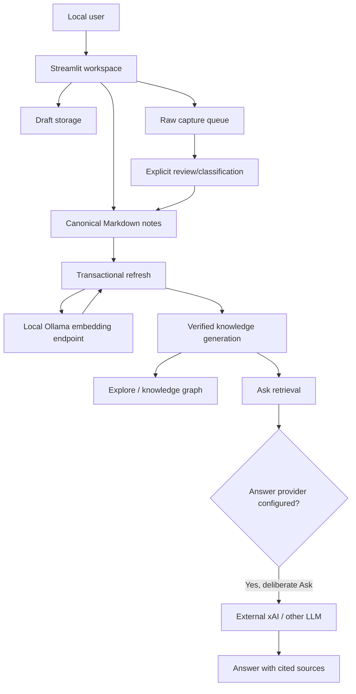

# SecondSelf — Technical architecture

## System boundary

SecondSelf is primarily a **local single-user** Python/Streamlit application, not a multi-tenant hosted service.

## Data lifecycle

1. The Capture and Library workspace writes locally managed notes with structured metadata and stable identifiers.
2. Save & Index invokes the same transactional refresh pipeline used by the CLI.
3. Refresh inventories canonical notes, checks fingerprints and vector provenance, embeds only necessary notes using a pinned provider/model, and writes a complete generation.
4. Ask and Explore consume verified active generations; stale and mixed-model artifacts are rejected rather than silently used.
5. Failure during indexing preserves the saved note and existing generated artifacts, with recovery through another controlled refresh.

## Boundaries and decisions

| Decision | Why | Trade-off |
|---|---|---|
| Markdown as canonical storage | Inspectable and portable notes | Structured metadata must be validated |
| Ollama for embeddings by default | Private, low marginal API cost, offline-capable | Local model download and runtime |
| Pin embedding provider/model identity | Prevent incomparable vectors from mixing | Changing model requires a full refresh |
| Transactional generation pointer | Avoid partially published graph/index combinations | Additional disk space and state management |
| Cloud answer model optional | Higher-capability synthesis when needed | Questions and excerpts leave the machine |
| Default-deny demo publication | Reduce accidental personal-data exposure | Public demo needs reviewed synthetic samples |

## Trust model

The local machine and its note store are the primary trust boundary. Never place API keys in checked-in configuration. Binding Streamlit to `127.0.0.1` avoids exposing a personal workspace on the network. Ollama's embedding endpoint is local; an external LLM request is a **separate** data disclosure and may be billable.

Browser safety checks exercise graph rendering with synthetic payloads. They are not a replacement for a full security audit.

## What has been validated

Local 768-dimensional Ollama embedding request; transactional refresh; one-note Ask response with a source; five-view UI loaded; Save & Index surfaced in Library and Explore; 80 automated tests reported passing with browser checks for the workspace change.

No comprehensive multi-user, scale, penetration, retrieval-quality, or production reliability benchmark has been completed.
